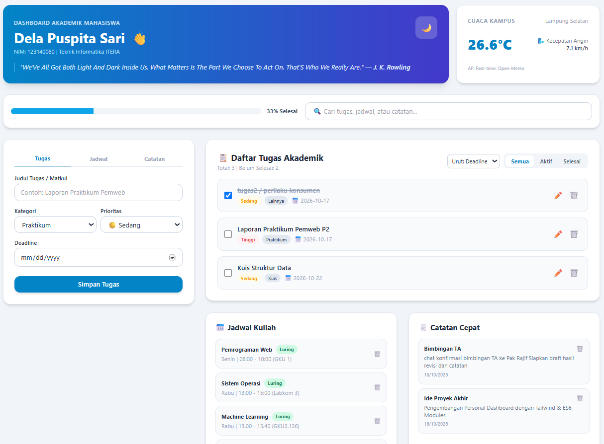
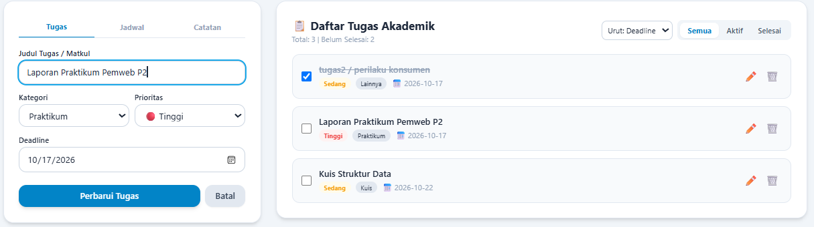
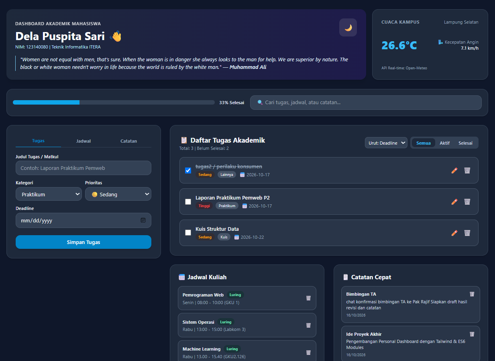
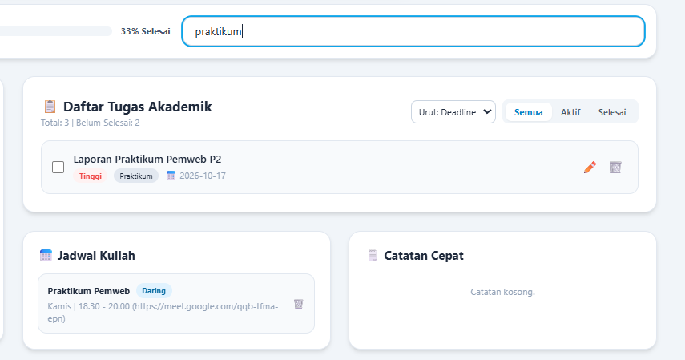
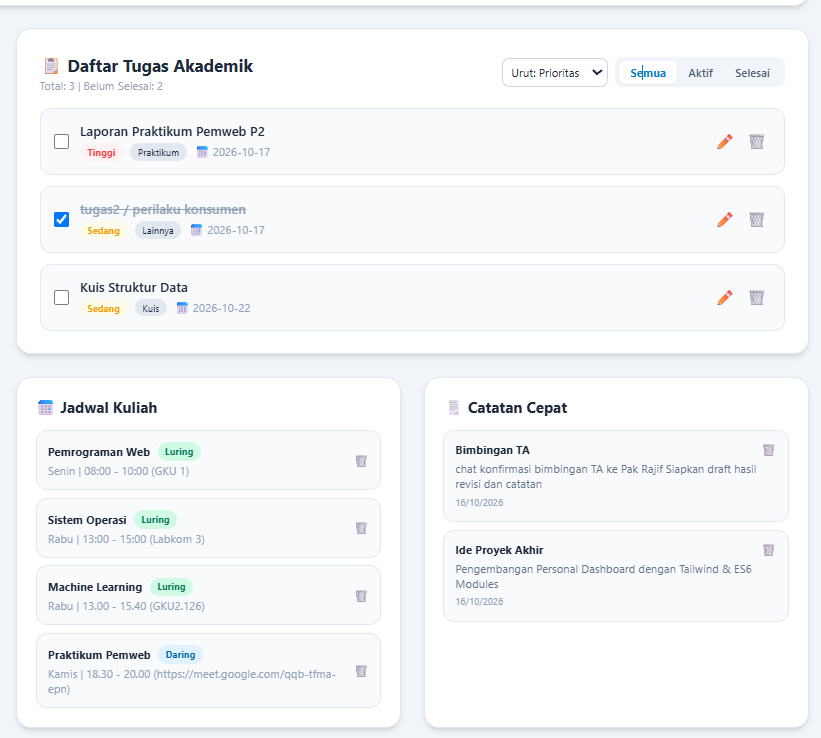

# Personal Dashboard - ITERA Academic Command Center

**Nama**: Dela Puspita Sari  

**NIM**: 123140080 

**Kelas**: Praktikum Pemrograman Web RB 

---

## 🚀 Tentang Proyek
**ITERA Academic Command Center** adalah aplikasi *front-end* personal dashboard yang dirancang khusus untuk membantu mahasiswa Teknik Informatika ITERA dalam mengelola produktivitas dan organisasi perkuliahan harian secara efisien.

Aplikasi ini menggabungkan fitur-fitur akademik penting seperti:
1. **Pengaturan Tugas (To-Do List)**: Mencatat, mengedit, menghapus, serta menandai status penyelesaian tugas perkuliahan.
2. **Jadwal Kuliah**: Menampilkan dan mengelola jadwal harian/mingguan lengkap dengan penanda metode kuliah (Daring/Luring).
3. **Catatan Singkat**: Wadah cepat untuk mencatat ide, rangkuman, atau informasi penting perkuliahan.
4. **Widget Cuaca & Motivasi Real-Time**: Integrasi langsung data cuaca Kampus ITERA dan kutipan motivasi harian.

Semua fitur dikelola secara interaktif menggunakan JavaScript modern (ES6+) berbasis arsitektur modular, memastikan pengalaman pengguna yang responsif, rapi, dan cepat.

---

## 🛠️ Dibangun Dengan
Proyek ini dikembangkan menggunakan kombinasi teknologi *front-end* modern:
- **HTML5**: Struktur semantik antarmuka web.
- **Tailwind CSS**: *Framework* CSS berbasis *utility-first* untuk penataan gaya responsif dan modern.
- **JavaScript (ES6+)**: Logika aplikasi, manipulasi DOM, manajemen *state*, dan pemanggilan API.
- **Fetch API (Open-Meteo & DummyJSON)**: Sumber data *real-time* tanpa API Key.

---

## ✨ Fitur Aplikasi Utama
Berikut adalah daftar fungsionalitas inti yang ditawarkan oleh Dashboard ini:

- **Daftar Tugas Interaktif**: Fitur CRUD (Create, Read, Update, Delete) tugas dilengkapi status penyelesaian, skala prioritas (Tinggi, Sedang, Rendah), dan tanggal tenggat (*deadline*).
- **Manajemen Jadwal Kuliah**: Pengelolaan daftar mata kuliah harian (Senin–Minggu) dengan opsi metode pembelajaran (🏫 Luring / 💻 Daring) dan lokasi ruangan.
- **Catatan Pribadi Sederhana**: Modul pencatatan cepat untuk menyimpan gagasan atau pengingat penting perkuliahan.
- **Live Progress Bar**: Indikator persentase otomatis yang menghitung tingkat penyelesaian seluruh tugas secara *real-time*.
- **Pencarian & Pengurutan Dinamis**: Kolom pencarian kata kunci lintas modul serta pengurutan tugas berdasarkan tanggal tenggat atau prioritas.
- **Toggle Theme (Mode Gelap/Terang)**: Penyesuaian tampilan visual (Dark/Light Mode) yang tersimpan otomatis di penyimpanan lokal.
- **Widget Cuaca ITERA**: Menampilkan suhu dan kecepatan angin *real-time* di wilayah Lampung Selatan.

---

## 🧠 Implementasi JavaScript Modern (ES6+)
Proyek ini memanfaatkan fitur-fitur utama ECMAScript 6 (ES6+) dan arsitektur Object-Oriented Programming (OOP) modern:

- **Deklarasi Variabel Modern**: Penggunaan `let` dan `const` secara terstruktur sesuai lingkup (*scope*) variabel.
- **Fungsi Panah (Arrow Functions)**: Diterapkan pada *method* kelas, fungsi *callback* event listener, serta operasi iterasi array (`.map()`, `.filter()`, `.sort()`).
- **Template Literals**: Digunakan untuk menyuntikkan elemen HTML dinamis dan menyusun string URL API secara mulus.
- **Classes (OOP)**: Implementasi Class `TaskItem`, `ScheduleItem`, dan `NoteItem` pada `js/modules/Models.js` untuk pemodelan data, serta `DashboardApp` pada `js/modules/DashboardApp.js` untuk pengontrol logika utama.
- **Async / Await**: Penanganan operasi asinkron HTTP Request menggunakan `fetch()` pada metode `fetchWeather()` dan `fetchQuote()`.
- **Destructuring & Spread Operator**: Ekstraksi properti objek pada parameter fungsi serta pembaruan array secara *immutable* (`[newTask, ...this.tasks]`).
- **ES Modules**: Pemisahan kode berbasis modul menggunakan sintaks `import` dan `export` via `js/main.js`.
- **Penyimpanan Lokal (localStorage)**: Persistensi data tugas, jadwal, catatan, dan tema agar data tidak hilang saat halaman dimuat ulang.

---

## 🖼️ Tampilan Aplikasi

Berikut adalah dokumentasi antarmuka aplikasi ITERA Academic Command Center:

### 1. Tampilan Utama

*Menampilkan header profil mahasiswa (Dela Puspita Sari - 123140080), widget cuaca real-time kampus ITERA, kutipan motivasi, indikator progress bar, serta ringkasan tugas.*

### 2. Penambahan & Edit Tugas

*Antarmuka form interaktif untuk menambah tugas baru atau memperbarui tugas yang sudah ada lengkap dengan pilihan kategori, prioritas, dan tanggal tenggat.*

### 3. Toggle Theme (Mode Gelap)

*Demonstrasi fitur perubahan tema ke Mode Gelap (Dark Mode) untuk kenyamanan penggunaan di kondisi redup cahaya.*

### 4. Fungsi Pencarian & Pengurutan

*Fitur penyaringan tugas dinamis berdasarkan kata kunci serta pengurutan berdasarkan tingkat prioritas dan tanggal deadline.*

### 5. Modul Jadwal Kuliah & Catatan Cepat

*Tampilan pengelolaan jadwal kuliah mingguan dengan opsi status Daring/Luring serta modul catatan cepat harian.*
